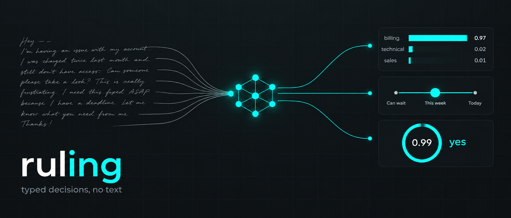

<p align="center">
  
</p>

## ruling: _typed decisions_, not generated text, from open models

**Documentation:** [docs/](docs/README.md)

----

ruling turns any open chat model into a decision engine like TypeSafe's
[Jev](https://typesafe.ai/blog/introducing-system-one-models-and-jev). You send
a state (text, JSON or images) and typed questions; you get back a probability
for every option you declared. Nothing is generated, so there is nothing to
parse and the model cannot invent an answer you did not list. It runs on your
own machine, serves TypeSafe's API so their client works against it unchanged,
and learns from the outcomes of the decisions it serves.

On the 256 public judgments that carry Jev's own answers, a 19 GB open model
with no training gets 231 right to Jev's 238, not a significant difference
(exact McNemar, p = 0.21); [the results](docs/results.md) also say where Jev
is ahead. Not affiliated with TypeSafe AI.

## Documentation

The usual starting points: [Getting started](docs/getting-started.md),
[Choosing models](docs/models.md), [Fine-tuning](docs/fine-tuning.md), and the
[Reference](docs/reference.md) for every setting, command and API route. The
index is at [docs/README.md](docs/README.md).

## Installation

You need an Apple Silicon Mac and Python 3.12+.

```bash
pip install ruling            # or: uv tool install ruling; add [vision] to ask about images
ruling serve                  # downloads a 2.3 GB model on first start, then serves http://127.0.0.1:8010
```

Open `http://127.0.0.1:8010/` for the playground. To work on ruling itself,
clone the repository and `uv sync`; see [Development](docs/development.md).
On NVIDIA, see [vLLM](docs/reference.md#on-nvidia-vllm). Before relying on an
answer, read the [limits](docs/getting-started.md#limits).

## Reading more

- [Results](docs/results.md) and the [full measurements](docs/measurements.md),
  with the command behind every number.
- [How it works](docs/how-it-works.md): one prefix, many suffixes, and reading
  logits instead of sampling.
- [Design notes](docs/design.md) and [Background](docs/background.md): what Jev
  is, why ruling is built the way it is, the other open recreations, and the
  papers behind the calibration.

## License

MIT. ruling is an independent project with no connection to TypeSafe AI; "Jev"
and "System One" are their names, used here to say what this reproduces. The
`authored144` and `perturbations108` datasets and the WANLI row selection are
converted from TheoLeeCJ/openjev under MIT, with their copyright notice in
[THIRD_PARTY.md](THIRD_PARTY.md). WANLI is CC-BY-4.0 and SST-5 keeps its own
terms; neither is committed here. Model weights keep their own licenses.
