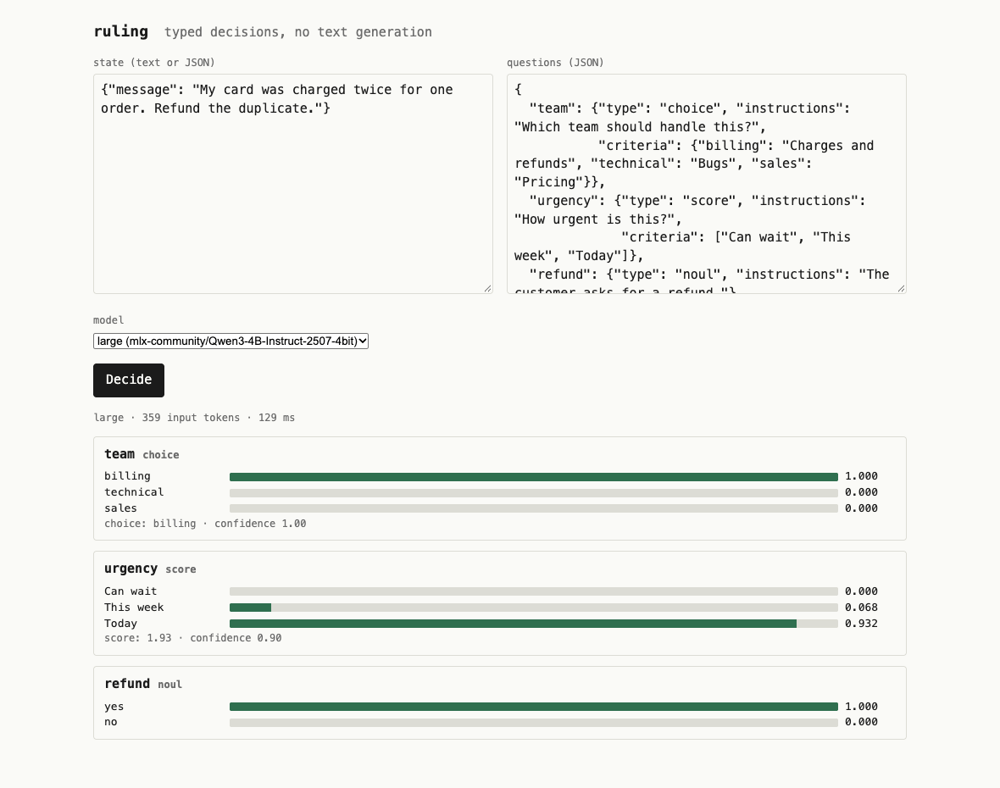

# Getting started

## Try it in two minutes

You need an Apple Silicon Mac and Python 3.12+. Install from PyPI, or
[from a checkout](development.md) with `uv sync` and `uv run` in front of
each `ruling` command below.

```bash
pip install ruling           # or: uv tool install ruling
ruling serve                 # downloads a 2.3 GB model on first start, then serves http://127.0.0.1:8010
```

```bash
curl -s localhost:8010/v1/systemone -H 'content-type: application/json' -d '{
  "state": {"message": "My card was charged twice for one order. Refund the duplicate."},
  "questions": {
    "team":    {"type": "choice", "instructions": "Which team should handle this?",
                "criteria": {"billing": "Charges and refunds", "technical": "Bugs", "sales": "Pricing"}},
    "urgency": {"type": "score",  "instructions": "How urgent is this?",
                "criteria": ["Can wait", "This week", "Today"]},
    "refund":  {"type": "noul",   "instructions": "The customer asks for a refund."}
  }}'
```

```json
{
  "model": "mlx-community/Qwen3.5-4B-4bit",
  "answers": {
    "team":    {"type": "choice", "choice": "billing",
                "probabilities": {"billing": 0.997, "technical": 0.002, "sales": 0.001}, "confidence": 0.995},
    "urgency": {"type": "score", "score": 1.74, "legend": {"0": "Can wait", "1": "This week", "2": "Today"},
                "probabilities": {"0": 0.066, "1": 0.131, "2": 0.803}, "confidence": 0.606},
    "refund":  {"type": "noul", "noul": 0.955}
  },
  "usage": {"input_tokens": 405, "output_tokens": 0}
}
```

Three question types: **choice** picks one option, **score** places the state
on an ordered scale, **noul** judges whether a statement is true, or which of
two descriptions fits. Ask up to 64 in one request; the state is read once.

## The playground

`http://127.0.0.1:8010/` is a page with a state box, a questions box, a model
picker filled from the server, and each answer's probabilities drawn as bars.
A refused request shows its status, code and message, so it is the quickest
way to see what a server answers for and how.



On a server started with `RULING_API_KEY`, enter the key in the playground; it
is kept for the browser tab only. The model picker lists every name the server
answers to; [serve several models](models.md#serve-several-models-from-one-process)
to compare them on the same state.

## Ask in plain words

The playground's **ask** tab takes a question in words instead of typed
questions. The model is first asked nine typed questions *about* the input,
in one request: whether it can be judged at all, what kind of question it is
(a yes or no, a pick, a how much, a how likely), whether it is several
questions, whether it is finished and fit to show, and the answer read three
ways. For a yes-or-no or a how-much on a general scale, that first request
already holds the answer and nothing is generated. A pick or a scale with its
own units needs options written, and the same model writes them as a short
JSON tool call, allowed only the kinds of question the rules asked for; then
it judges what it wrote, and only that judgment is shown. Each shown answer
is sent back once more as "is this right?", and the page says whether the
model stands by it. Under the answer, "how it got there" shows all nine
readings and the writer's reply byte for byte, and **open in decide** puts
the typed questions behind the answer into the decide tab to read or change.

A question can come with pictures: pick them under the question box on a
`vision:` model, and they travel with the input as `<image 1>`, `<image 2>`,
… Every reading is made with the pictures in view, and a vision model writes
the options with them in front of it, so "what is this?" of a photo becomes a
pick over what it sees.

```bash
ruling ask "is a hot dog a sandwich?"        # the same, without a server; prints the whole reading as JSON
```

The nine questions and the rules follow [lmjtfy](https://lmjtfy.fun), credited
in [THIRD_PARTY.md](../THIRD_PARTY.md). How reliably open models read the
25 routing cases that wording was measured on is in
[Measurements](measurements.md#reading-a-question-in-plain-words).

## Ask about images

The default Qwen3.5 models can see. Serve one as a `vision:` model and put
images anywhere in the state as `{"type": "image", "media_type", "data"}`
objects; questions refer to them as `<image 1>`, `<image 2>`, … in order:

```bash
pip install 'ruling[vision]'     # from a checkout: uv sync --extra vision
RULING_MODEL=vision:mlx-community/Qwen3.5-4B-4bit ruling serve
```

```bash
curl -s localhost:8010/v1/systemone -H 'content-type: application/json' -d '{
  "state": {"note": "Customer says the parcel arrived crushed.",
            "photo": {"type": "image", "media_type": "image/jpeg", "data": "'"$(base64 < parcel.jpg)"'"}},
  "questions": {"damaged": {"type": "noul", "instructions": "<image 1> shows a damaged parcel."}}}'
```

In the playground, pick image files under the state box; they are added to
the state as `images` and shown with the `<image N>` name to ask about them
by. The picker is off for a model that reads text only. **image example**
loads a support note with a receipt drawn in the page and three questions
that need both; a server whose default model reads images opens on it.

The state and its images are read once, however many questions you ask:
eight 12-megapixel photos and nine questions took 10 s and 7.2 GB on the 4B
model. Up to 8 images of 5 MB each, PNG, JPEG or WebP. Any vision model behind
an OpenAI-compatible server reads them too, through `openai:`; see the
[API reference](reference.md#api). To teach a `vision:` model your own
decisions about images, see [Fine-tune on images](fine-tuning.md#fine-tune-on-images).

## Call it from code

- **Python**, in this package: `from ruling import RulingClient`. Decisions,
  outcomes, batches of rows, evaluations, usage, image helpers and retries;
  see [Clients](reference.md#clients).
- **TypeScript and JavaScript**, zero dependencies, in
  [`sdks/typescript`](../sdks/typescript).
- **TypeSafe's own SDK**, unmodified: point `TYPESAFE_BASE_URL` at the
  server; see [the reference](reference.md#typesafes-own-sdk-talks-to-ruling).
- **The command line**: `ruling ask` answers once without a server, typed
  questions or a question in words, and `ruling predict` answers a whole file
  of rows; see [Command line](reference.md#command-line).
- **Batches over HTTP**: `POST /v1/predict` answers thousands of rows in one
  request and `POST /v1/evaluations` scores labeled ones; see
  [the API](reference.md#api).

## Limits

- Probabilities are model scores. Calibration makes them honest on average on
  data like your calibration set; it does not make any single answer right.
- A local MLX model answers one request at a time; questions inside a request
  are batched. Up to `RULING_MAX_PENDING` requests wait their turn, and the
  next is refused with 429 and a `Retry-After`.
- The state is untrusted input: text in it can steer the answers (prompt
  injection), as with any model that reads it. Put independent checks in front
  of security-sensitive actions rather than acting on an answer alone.
- Images need a `vision:` model or an `openai:` vision host; the plain MLX
  path and `vllm:` read text only. No audio, no generated explanation.
- The native engine is MLX, so the fast path is Apple Silicon. On NVIDIA,
  ruling serves through `vllm:` (vLLM's own decision endpoint) or `openai:`
  against a stock vLLM or llama.cpp; see
  [On NVIDIA: vLLM](reference.md#on-nvidia-vllm).
