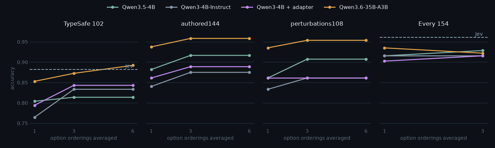
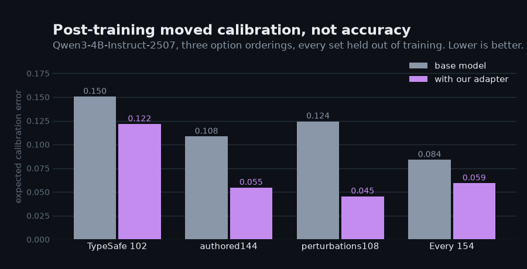
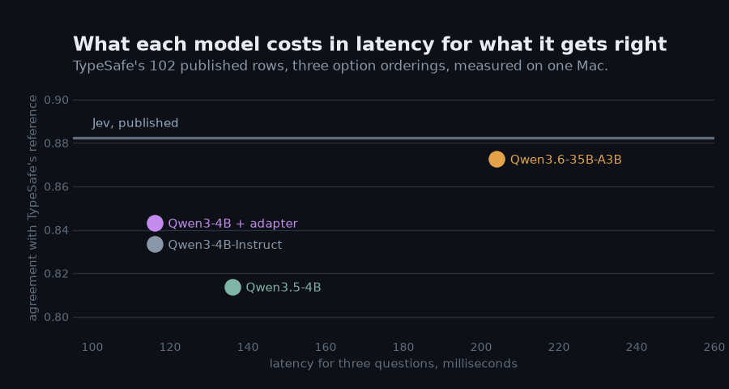
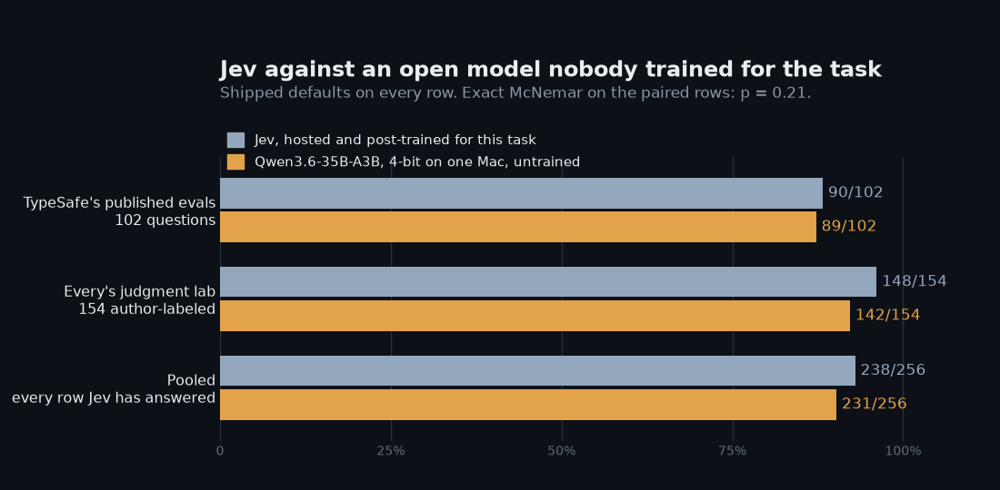

# Measurements

The complete measurement record: how to run the harness, every model on every held-out set at every
setting, what ordering averaging and post-training bought, latency, and the comparison with Jev's own
published answers. [Results](results.md) carries the summary; this file carries everything, unchanged,
with the command behind every number.

## Running the harness

Datasets are JSONL records with a state, questions in the API shape, and a
label per question. Four are bundled and two more build from pinned public
sources; see [datasets/README.md](../datasets/README.md).

```bash
uv run ruling eval datasets/authored144.jsonl                   # metrics per question type
uv run ruling eval datasets/authored144.jsonl --rotations 1     # same, one ordering
uv run ruling build-dataset wanli --output datasets/wanli256.jsonl
uv run ruling calibrate datasets/wanli256.jsonl --output calibration.json
RULING_CALIBRATION=calibration.json uv run ruling serve
```

`eval` reports, per question type: accuracy, balanced accuracy, mean
per-family balanced accuracy when records carry a `family`, expected
calibration error, Brier score, negative log-likelihood, and mean confidence.
For Choice questions it also scores every record with the options reversed and
reports how many argmax answers flip. Reports record the model's Hugging Face
revision and the scoring settings.

`calibrate` fits one temperature per question type by minimizing negative
log-likelihood. The file records the model, revision, rotation count, and
debiasing setting it was fit under, and the server refuses to load it against
anything else.

## Text decisions

Every number in this section comes from one batch, run on 18 September 2026 on
a single Apple Silicon Mac: one code version, one sitting, four models against
the same four held-out sets, with no calibration file loaded (temperature 1.0)
and prior debiasing off. Reproduce a cell with

```bash
uv run ruling eval <dataset> --model <model> --rotations <n>
```

**How the defaults were chosen, and what leaked.** `RULING_ROTATIONS=3` was
originally picked because it scored best on `authored144`, so that set is not
clean evidence for it. TypeSafe's 102 rows and Every's 154 were scored
afterwards and confirm it independently. Prior debiasing was tried the same way
and lost on every model and dataset, so it ships off.

### Every model on every held-out set

Accuracy, as argmax agreement with each set's own reference labels. `r` is the
number of option orderings averaged per question.

| model | typesafe102 (102) | authored144 (144) | perturbations108 (108) | Every (154) |
|---|---|---|---|---|
| | r=1 / r=3 / r=6 | r=1 / r=3 / r=6 | r=1 / r=3 / r=6 | r=1 / r=3 |
| Qwen3.5-4B, the default | 0.804 / 0.814 / 0.814 | 0.882 / 0.917 / 0.917 | 0.861 / 0.907 / 0.907 | 0.916 / 0.929 |
| Qwen3-4B-Instruct-2507 | 0.765 / 0.833 / 0.833 | 0.840 / 0.875 / 0.875 | 0.833 / 0.861 / 0.861 | 0.916 / 0.916 |
| Qwen3-4B-Instruct + our adapter | 0.794 / 0.843 / 0.843 | 0.861 / 0.889 / 0.889 | 0.861 / 0.861 / 0.861 | 0.903 / 0.916 |
| Qwen3.6-35B-A3B, 19 GB | 0.853 / 0.873 / **0.892** | 0.938 / 0.958 / 0.958 | 0.935 / 0.954 / 0.954 | **0.935** / 0.922 |
| Jev, published | 0.882 | — | — | 0.961 |

Jev has one number per set because rotations are ruling's setting, not
TypeSafe's, and it has no entry on the two authored fixtures because those are
[TheoLeeCJ's](https://github.com/TheoLeeCJ/openjev) and Jev was never run on
them. Every skips r=6: its questions carry at most three options, and the
engine caps orderings at the option count, so r=6 there is the same computation
as r=3.

### Other open decision models, run locally

Four more trained decision models from the Hub, each run through its
publisher's own inference code (or, for the 27B, the community MLX port of
it) as a `/v1/systemone` server on the same Mac, and scored by `ruling eval`
with `--model typesafe:<name>` exactly as Clef-flash was: one ordering,
temperature 1.0, prior debiasing off, the host's own probabilities passed
through. Run on 13 October 2026 at ruling commit `e812c7c`, one model loaded
at a time; everything the harness wrote is under `runs/bench/`
(`serve.sh` starts a server, `score.sh` scores it, `summary.py` prints the
numbers below from the result JSON).

| model | how it was run | weights |
|---|---|---|
| pplx-decider-v1.1-27b, Perplexity | `mlx-community/pplx-decider-v1.1-27b-4bit` at `66383f28`: the port's `server.py`, which implements the publisher's noncausal full-attention layers, 255-row readout head and saved calibration temperature 1.00874 (the port reports 33 of 33 argmax agreements and mean KL 0.0014 against the publisher's PyTorch bf16 code; the backbone is 4-bit, the readout bf16) | 15.3 GB |
| decider-4b v2.1, Mapika | `Mapika/decider-4b` at `99d7fd5b` through the publisher's `decider-ai` 1.9.0 (`uvicorn decider.serve:app`), on PyTorch MPS in float16, the package's own Apple Silicon default; per-type temperatures from its `decider_config.json` (choice 1.11, noul 1.56, score 1.287) | 8.4 GB bf16 |
| decider-2b v11, Mapika | `Mapika/decider-2b` at `ff99089b`, the same package and device; temperatures choice 1.164, noul 1.624, score 1.124 | 3.8 GB bf16 |
| bev-decider-0.4B, avbiswas | `avbiswas/bev-decider-0.4B` at `cf5138b5` through the publisher's `bev-decider` 0.2.1 (`bev-decider serve`), MPS, bf16, the package's 2,048-token state limit (longer states are truncated by the package, silently) | 1.0 GB |

Two publisher limits shape the TypeSafe column. pplx-decider rejects any
prompt over 8,192 tokens rather than truncating it, in the publisher's
reference code and in the port; 13 of TypeSafe's 102 rows are longer than
that, so it was scored on the 89 it could read (the harness records the rest
as unscored; `assets/bench/proxy413.py` only turns the server's HTTP 400 for
that rejection into the 413 the harness expects, and touches nothing else).
bev-decider truncates states to 2,048 tokens, which affects 47 of those 102
rows.

Accuracy, as argmax agreement with each set's own reference labels, then
coverage at a 5% error budget, all question types pooled, as in [Results](results.md):

| model | typesafe102 (102) | authored144 (144) | perturbations108 (108) | Every (154) |
|---|---|---|---|---|
| pplx-decider-v1.1-27b, 4-bit MLX port | 0.899 (80/89 read; 13 rows over its 8,192-token limit, 0.784 of 102 if they count as wrong) | 0.965 (139/144) | 1.000 (108/108) | 0.955 (147/154) |
| decider-4b v2.1 | 0.814 (83/102) | 0.910 (131/144) | 0.880 (95/108) | 0.942 (145/154) |
| decider-2b v11 | 0.755 (77/102) | 0.868 (125/144) | 0.917 (99/108) | 0.935 (144/154) |
| bev-decider-0.4B | 0.627 (64/102) | 0.681 (98/144) | 0.657 (71/108) | 0.877 (135/154) |
| Clef-flash 9B, 4-bit MLX port, from above | 0.892 (91/102) | 0.903 | 0.954 | 0.955 |

| coverage at 5% error | typesafe102 | authored144 | perturbations108 | Every |
|---|---|---|---|---|
| pplx-decider-v1.1-27b, 4-bit MLX port | 0.854 (the 89 rows read) | 1.000 | 1.000 | 1.000 |
| decider-4b v2.1 | 0.588 | 0.896 | 0.815 | 0.987 |
| decider-2b v11 | 0.294 | 0.715 | 0.787 | 0.935 |
| bev-decider-0.4B | 0.020 | 0.340 | 0.000 | 0.669 |
| Clef-flash 9B, 4-bit MLX port, from above | 0.843 | 0.764 | 1.000 | 1.000 |

Two of these numbers can be checked against the publishers' own cards.
decider-2b's card reports 75.5% on the same 102 TypeSafe rows; this run got
77 of 102, the same number. Its card also gives JevBench public tiers of
1.000 / 0.889 / 0.577; below, this run has 1.000 / 0.889 / 0.568, one hard
item apart, on float16 MPS against the card's bf16 CUDA.

Latency through each server, one request at a time, median per record:
pplx-decider 862 ms on Every's rows and 3,598 ms on TypeSafe's long
states (the port prefilled 682,860 tokens in 1,096 GPU-seconds over the whole
run, about 620 tokens per second, from its `/stats`); decider-4b 161 ms and 1,143 ms; decider-2b 86 ms and 499 ms;
bev-decider 25 ms and 104 ms. The two Mapika models run eager on MPS, where
the package captures no graphs.

### What ordering averaging buys



Going from one ordering to three is worth 1 to 5 questions on every model and
set. Going from three to six changes nothing anywhere except TypeSafe's rows,
where the 35B gains two more — and those are the only questions in any of these
sets with five options. `Engine._rotations_for` caps orderings at the number of
options, so the flat cells are flat by construction, not by chance.

The dashed line is Jev's published figure on the two sets where it has one. The
flat right-hand halves are the cap at work, and the 35B crossing Jev on
TypeSafe's rows at six orderings is the only crossing anywhere in these panels.

What averaging reliably buys is order stability. Rescoring every row with its
options reversed, counting answers that flip:

| model | authored144 r=1 | r=3 | Every r=1 | r=3 |
|---|---:|---:|---:|---:|
| Qwen3.5-4B | 15 | 6 | 26 | 5 |
| Qwen3-4B-Instruct | 15 | 5 | 29 | 12 |
| Qwen3-4B-Instruct + adapter | 12 | 3 | 24 | 6 |
| Qwen3.6-35B-A3B | 6 | 4 | 9 | 3 |

### What post-training bought

The adapter weights are not published; the corpus and the run that produced
them are. `ruling build-corpus public|states|worlds` rebuilds the training
records from pinned public datasets and the generators in this repository
([the full recipe](adapter.md#how-to-reproduce-it), with counts, seeds and
every held-out set), and the command below reproduces the adapter on a Mac in
about 40 minutes:

```bash
uv run ruling train \
  --data runs/pool/public.jsonl runs/pool/states.jsonl runs/pool/worlds.jsonl \
  --holdout datasets/authored144.jsonl datasets/perturbations108.jsonl runs/eval/typesafe102.jsonl \
            runs/eval/every.jsonl runs/eval/wanli256.jsonl runs/eval/sst5.jsonl runs/eval/dev.jsonl \
  --model mlx-community/Qwen3-4B-Instruct-2507-4bit --output runs/adapters/v1
```

`ruling train` fine-tuned a LoRA adapter on 27,021 constructed records —
reframed public datasets, generated program states, and synthetic worlds — with
every evaluation set above passed to `--holdout`. In-distribution validation
accuracy went from 0.607 to 0.844.

Held out, the adapter is worth 1 to 3 questions of accuracy at one ordering and
approximately nothing at three. What it does move is calibration, in all eleven
comparisons:



| set | expected calibration error, base → adapter |
|---|---|
| typesafe102 r=1 | 0.228 → 0.162 |
| typesafe102 r=3 | 0.150 → 0.122 |
| authored144 r=3 | 0.108 → **0.055** |
| perturbations108 r=3 | 0.124 → **0.045** |
| Every r=3 | 0.084 → 0.059 |

Training on a proper scoring rule made the probabilities honest without making
the judgments better, and the effect carried to distributions the adapter never
saw. The accuracy gain concentrates at r=1 and vanishes by r=3, which says
training and ordering averaging are correcting the same defect — positional
bias — and do not stack. With the adapter you can run one ordering and keep
three-ordering accuracy, at half the latency.

### Noul and Score, held out

Earlier batch, `Qwen3.5-4B-4bit`, kept because these two sets were not re-run.

| Dataset | Rows | Type | Metric | r=1 | r=3 |
|---|---:|---|---|---:|---:|
| WANLI | 256 | noul, "the evidence establishes this claim" | balanced accuracy | **0.853** | 0.827 |
| | | | ECE | 0.048 | 0.081 |
| SST-5 | 300 | score, five sentiment levels | accuracy | **0.530** | 0.487 |
| | | | balanced accuracy | 0.477 | 0.464 |
| | | | ECE | 0.086 | 0.121 |

SST-5 is a five-way ordinal task where fine-tuned encoders reach about 0.59.
Zero-shot, from a 4-bit 4B model, 0.53 with an ECE under 0.1 is usable.

### Reading a question in plain words

`ruling ask` and the playground's ask tab put nine typed questions to the
model about a question typed in words (`ruling/ask.py`), and the rules act
on the answers. The 25 routing cases in `datasets/routing/ask25.jsonl`,
adapted from lmjtfy's, say how each input should be read: whether it is
answerable, which kinds it may be read as, whether it needs its own scale,
whether it is several questions, and whether it is fit to show. A case
passes when every fact it has a view on is read its way. Run on 16 October
2026, temperature 1.0, prior debiasing off:

| model | cases right | answerable | reads | scale | several | fit | whole |
|---|---:|---:|---:|---:|---:|---:|---:|
| Qwen3.5-4B, 1 ordering | 12 of 25 | 19 | 23 | 22 | 24 | 23 | 25 |
| Qwen3.5-4B, 3 orderings | 18 of 25 | 21 | 24 | 25 | 24 | 24 | 25 |
| Qwen3.6-35B-A3B, 3 orderings | **23 of 25** | 24 | 25 | 24 | 25 | 25 | 25 |
| Jev, as lmjtfy reports | 25 of 25 | | | | | | |

The per-fact columns count cases whose answer to that fact matched, out of
the 25 (or the cases with a view, for `scale` and `several`). The 35B misses
two: it reads "how good is the movie The Matrix?" as needing its own scale,
and "rate my startup idea: uber for dogs" as not a question its types
answer. The 4B at three orderings misses those two, splits "should I
rewrite it in rust" into a yes-or-no and a pick, takes "What are the
chances that all recent slot machines are vibe-coded?" for something it
cannot judge, and refuses the two unfit cases outright as unanswerable,
where the cases expect them read as yes-or-no questions and marked unfit;
on this wording a refusal is the safer reading. Every input is read as
finished by every model.

### Latency and throughput

Median of five requests, short JSON state, engine warm, same batch as the
accuracy numbers above.

| Request | | Qwen3.5-4B | Qwen3-4B-Instruct | Qwen3.6-35B-A3B |
|---|---|---:|---:|---:|
| 3 questions (Choice + Score + Noul) | r=1 | 80 ms | 78 ms | 141 ms |
| | r=3 | 136 ms | 116 ms | 204 ms |
| 21 Noul questions, one state | r=1 | 216 ms, 97/s | 178 ms, 118/s | 263 ms, 80/s |
| | r=3 | 495 ms, 42/s | 399 ms, 53/s | 606 ms, 35/s |

Every setting lands inside Jev's claimed 70 to 500 ms window for the
three-question request, including the 35B that reaches Jev's accuracy on
TypeSafe's rows. Run-to-run variation is real: the 35B measured 228 ms at r=3 a
day earlier on the same machine, about 10% above this batch. Measured on an
idle machine; under concurrent load the same requests took two to three times
longer, because requests queue behind a lock rather than batching together.



*What each model costs for what it gets right. Jev's line is its published
accuracy; its latency is a vendor range, 70 to 500 ms, so it is drawn as a line
rather than a point.*

## Against Jev

Two public sources carry Jev's own answers on inputs anyone can replay.
`ruling build-dataset typesafe` and `ruling build-dataset every` rebuild them
with Jev's answer attached to every question, and `ruling eval` reports how
often ruling lands on the same answer. Both were run with the default
settings; the one-ordering numbers are in parentheses.

### TypeSafe's published evaluation cases



TypeSafe's reference on these 102 questions is the mean of GPT-6 Astra and
Claude Fable 5.1 at high reasoning, so this measures agreement with large models on workflows TypeSafe built,
not accuracy against truth.

| System | Agrees with TypeSafe's reference | Agrees with Jev's argmax |
|---|---:|---:|
| ruling, 35B-A3B, r=6 | **0.892** (91/102) | 0.853 |
| Jev, published | 0.882 (90/102) | |
| ruling, 35B-A3B, r=3 | 0.873 (89/102) | 0.853 |
| ruling, 35B-A3B, r=1 | 0.853 (87/102) | 0.833 |
| TheoLeeCJ/openjev, 4B BF16 | 0.85 | |
| ruling, Qwen3-4B-Instruct + adapter, r=3 | 0.843 (86/102) | 0.824 |
| ruling, Qwen3.5-4B, r=3 | 0.814 (83/102) | 0.824 |

On the default 4B model Jev is better here by about seven points, and on the
35B the two are level: 91 of 102 against Jev's 90 of 102. One question is a tie,
not a lead.

Pooled with Every's 154 labeled judgments — every row anywhere that carries
Jev's own answer — the 35B at shipped defaults gets 231 of 256 and Jev gets
238. An exact McNemar test on the paired rows gives **p = 0.21**: no
significant difference, with Jev nominally ahead. Taking the best rotation
setting per dataset instead gives 235 of 256 and p = 0.66; that number is
recorded here rather than quoted, because choosing a setting per dataset is
tuning on the evaluation.

### Every's parallel judgment lab

[Every's parallel judgment lab](https://typesafe-parallel-judgment-lab.every-4573.chatgpt.site/)
holds 758 judgments on 208 documents. Every recorded Jev's answers for nine
experiments in August 2026. Three of them
carry author labels (the support-reply judge grid and two retrieval grids,
154 judgments); the rest measure agreement only.

| | Jev | Qwen3.5-4B | 35B-A3B |
|---|---:|---:|---:|
| Accuracy on the 154 author-labeled judgments | **0.961** | 0.929 (0.916) | 0.922 (0.935) |
| Agreement with Jev, all 758 judgments | | 0.858 (0.832) | 0.922 (0.921) |

Jev leads on the author-labeled rows by three points against the 4B and four
against the 35B; these 154 rows are the one place on this page where Jev is
ahead of everything we run. The 35B tracks Jev's own answers much more closely
than the 4B does, 0.922 against 0.858 across all 758 judgments. Note that both
open models score *higher* than the 35B on the labeled subset at three
orderings while agreeing with Jev *less* — agreement with Jev and accuracy
against the authors are different measurements, and this set is small enough
that a few questions separate them.

**What the published data says about Jev's mechanism.** Every's file records
token usage per experiment. Jev reports almost exactly 16 output tokens per
judgment in every experiment (16.0 to 17.0 across six of them, from 5 to 21
questions per call), and roughly 350 to 400 input tokens per call beyond the
document and question text. A constant per-question output budget is
consistent with a fixed answer block computed in parallel per question rather
than a decoded string. Probabilities are published to two decimals. The
models endpoint lists `jev-latest`, released 2026-09-10, and `jev-preview`.

**Live comparison.** `ruling eval <dataset> --against typesafe` sends every
record to the hosted API with `TYPESAFE_API_KEY` and reports Jev's live
answers next to ruling's on the same rows, including the author-labeled
datasets above where Jev has never been measured. The client speaks
TypeSafe's protocol, which is the same as ruling's, and is tested end to end
against a ruling server. It needs API credits on the TypeSafe account; the
run for this page stopped at `402 Payment Required` before any call was
scored.

### JevBench, the public items

[JevBench](https://github.com/fstandhartinger/jevbench) is a third-party
leaderboard of 534 frozen typed decisions: routing, adequacy judging, policy
checks, intent, ordinal severity, enum extraction. 231 are public; 303 are held
out and only the operator runs them. Every system is asked through its own
published interface and scored by argmax over the exact label set. We ran the
231 public items through `ruling serve` with the 35B at shipped defaults, one
request at a time, using the harness's own `typesafe` adapter unchanged; the
other rows are the operator's published per-task outcomes on the same items.

| system | all 231 | easy 48 | original 72 | hard 111 |
|---|---:|---:|---:|---:|
| GPT-5.6 Luna, low reasoning | 0.974 | 1.000 | 0.972 | 0.964 |
| Gemini 3.1 Flash-Lite | 0.870 | 1.000 | 0.986 | 0.739 |
| Jev 1.13.0 | 0.866 | 1.000 | 0.986 | 0.730 |
| **ruling, Qwen3.6-35B-A3B, r=3** | **0.857** | 1.000 | 0.958 | **0.730** |
| Clef-flash 9B, 4-bit MLX port, local | 0.792 | 1.000 | 0.944 | 0.604 |
| openjev-sglang, Qwen3.6-35B-A3B | 0.853 | 1.000 | 0.944 | 0.730 |
| SemIf, Qwen3.5-4B | 0.810 | 1.000 | 0.986 | 0.613 |
| Bespoke Nimble 9B | 0.797 | 1.000 | 0.931 | 0.622 |
| system-one-open, Gemma 4 E2B | 0.732 | 1.000 | 0.931 | 0.486 |
| pplx-decider-v1.1-27b, 4-bit MLX port, local | 0.892 | 1.000 | 1.000 | 0.775 |
| decider-4b v2.1, local | 0.831 | 1.000 | 0.986 | 0.658 |
| decider-2b v11, local | 0.758 | 1.000 | 0.889 | 0.568 |
| bev-decider-0.4B, local | 0.632 | 0.979 | 0.736 | 0.414 |

Two of Jev's 231 decisions separate it from ruling, both on the original 72;
on the 111 hard items, the long policy texts and multi-step reasoning where
every open model drops, the two are identical at 81 of 111. The 35B behind
`openjev-sglang` is the same weights read by a different engine, which puts
the engine's contribution at about one decision. The ordinary instruction
model at the top is the operator's own finding, not ours: this suite rewards
reasoning more than the TypeSafe and Every rows do, and a general model with
a little reasoning budget is out of reach for any one-pass readout here.

Clef-flash was run the same way, against the community MLX port's own
`/v1/systemone` server, unmodified. The four rows marked local below it were
run the same way again on 13 October 2026, each against its own server as
described under [Other open decision models](#other-open-decision-models-run-locally),
with the harness's `typesafe` adapter pointed at `127.0.0.1`
(`assets/bench/score.sh`; per-item results under `runs/bench/jevbench-<name>/`).
pplx-decider leads every row here, open or hosted, except the instruction
model at the top: 206 of 231, with all 72 original items and 86 of the 111
hard ones against 81 for Jev and the 35B. bev-decider's card reports 46.8 on the hard tier where this run has 41.4
(46 of 111 against 52); its easy and original tiers match the card exactly. It is level with Jev on TypeSafe's and
Every's rows but drops on the hard tier: 67 of 111, against 81 for both Jev
and the 35B.

Latency on the 231 items, one request at a time on one Mac: p50 0.17 s, p95
1.10 s. Calibration by tier, from the harness: easy ECE 0.000, original 0.044,
hard 0.159 with a Brier of 0.431, so the hard items are where the probabilities
overstate themselves as well as where the answers are wrong. Everything the
harness wrote, per-decision outcomes and raw responses included, is
reproducible with the commands in its README against a local `ruling serve`.

## Images

### Glance's fresh photo sets

[Glance](https://github.com/yoheinakajima/glance) (Apache-2.0) reads the
same kind of answer logits from Qwen3-VL-4B and publishes three sets of
photos taken after every model it compares was released, labeled by people
outside that project: Wikimedia Commons photos of 13 everyday classes,
iNaturalist photos of 10 organism groups, and iNaturalist photos of 7 insect
orders. We scored ruling's `vision:mlx-community/Qwen3.5-4B-4bit` on the
same items: the evaluation half of each set, 541 yes/no questions and 270
pick-one, with the photos fetched from the sources Glance's manifests name
(byte-identical to the files it scored; Commons thumbnails at 1280 px,
iNaturalist at its medium size) and only CC0, CC BY and CC BY-SA photos
kept. ruling ran at three orderings with the default 1,024-token image cap,
one question per request. Glance's numbers are its own published results;
its per-item files reproduce them exactly.

| set | yes/no: ruling 4B | yes/no: Glance, Qwen3-VL-4B | pick-one: ruling 4B | pick-one: Glance, Qwen3-VL-4B |
|---|---:|---:|---:|---:|
| Commons (131 / 65) | 0.916 | 0.931 | 0.892 | 0.862 |
| iNaturalist groups (200 / 100) | 0.940 | 0.940 | 0.920 | 0.920 |
| iNaturalist insect orders (210 / 105) | 0.890 | 0.943 | 0.914 | 0.990 |
| pooled (541 / 270) | **0.915** [0.889, 0.939] | 0.939 | **0.911** [0.878, 0.944] | 0.933 |

Intervals are 95%, 10,000 resamples of whole photos stratified by set, as
Glance computes them. Paired item by item on the two sets whose per-item
results Glance publishes, ruling minus Glance is −0.6 points on yes/no
[−3.0, +1.9] over 331 questions and +1.2 on pick-one [−2.4, +4.8] over 165:
no difference. The insect orders are where the 4B falls behind, by 5 points
on yes/no and 8 on pick-one (unpaired: Glance's per-item file for that set is
not published). The misses are recognition, not the readout: on yes/no 18 of
96 true statements were answered no against 5 of 114 false ones yes, and 5 of
the 9 pick-one errors called a fly a true bug or a bee. The best hosted
models in Glance's table reach 0.961 on yes/no (Gemini 3.1 Flash-Lite) and
0.937 on pick-one.

The 35B, `vision:mlx-community/Qwen3.6-35B-A3B-4bit`, run the same way,
closes most of that gap:

| set | yes/no: 35B | yes/no: 4B | pick-one: 35B | pick-one: 4B |
|---|---:|---:|---:|---:|
| Commons | 0.916 | 0.916 | 0.908 | 0.892 |
| iNaturalist groups | 0.955 | 0.940 | 0.910 | 0.920 |
| iNaturalist insect orders | 0.914 | 0.890 | 0.971 | 0.914 |
| pooled | **0.930** [0.907, 0.951] | 0.915 | **0.933** [0.904, 0.963] | 0.911 |

Paired against the 4B, only pick-one on insect orders moves clearly, +5.7
points [+1.9, +10.5]: the flies are fixed, 9 errors down to 3. Paired against
Glance on the two sets it publishes per item, the 35B is +0.3 [−1.8, +2.4] on
yes/no and +1.2 [−1.8, +4.8] on pick-one, level. On insect-order yes/no it
stays 3 points short of Glance's 0.943, now by saying yes too often (12 of
114 false statements) where the 4B said no too often. It takes 622 ms per
decision at the median against the 4B's 374 ms, and 20 GB at peak, within
ruling's default memory cap.

Median latency per decision for the 4B on one Mac was 374 ms: 916 ms for a yes/no about
a full-size Commons photo (Glance reports 1.1 s on an M5) and 277 ms on the
smaller iNaturalist photos (Glance: 0.33 s). Peak memory for the run was
4.1 GB. The photos stay out of this repository, as Glance keeps them out of
its own; the scripts that fetched and scored them are not part of it either.

### Fine-tuning a vision model on photos

The insect-order photos, split into stratified halves of 105 (seed 0), with
one Choice over the seven orders. `ruling train` on
`vision:mlx-community/Qwen3.5-4B-4bit` with 84 of the training half (21 held
for validation): 300 steps, batch 4, 16 LoRA layers, learning rate 3e-5,
1,024 image tokens; the saved adapter is the best validation checkpoint,
step 200. Twenty-three minutes on one Mac at 300 to 600 tokens a second,
23 GB physical footprint at peak. Scored on the other half:

| held-out 105 photos | 3 orderings: base | 3 orderings: adapter | 1 ordering: base | 1 ordering: adapter |
|---|---:|---:|---:|---:|
| accuracy | 0.886 | **0.924** | 0.876 | **0.933** |
| log loss | 0.302 | 0.474 | 0.394 | 0.521 |
| ECE | 0.048 | 0.074 | 0.039 | 0.055 |
| coverage at 5% error | 0.924 | 0.933 | 0.857 | 0.981 |
| confident errors (wrong at p ≥ 0.9) | 0.010 | 0.038 | 0.019 | 0.038 |

Paired over photos, 10,000 bootstrap draws: +3.8 points [−1.0, +9.5] at three
orderings (6 photos wrong to right, 2 right to wrong) and +5.7 [+1.0, +11.4]
at one. The adapter removes every fly error the base made; what remains is
true bugs, grasshoppers and wasps taken for one another. It is also sharper
than it is right: log loss and confident errors rise even as accuracy does,
so an adapter trained on photos wants a temperature fitted on a calibration
set it did not see, as any adapter here does. This split is not Glance's,
so the 0.886 baseline is not the 0.914 of the comparison above. Training
records with the photos are not committed.

Fitting that temperature, on the same 105 held-out photos split into two
stratified halves of 49 and 56 (seed 0): `ruling calibrate` on one half,
`ruling eval --calibration` on the other, both ways, and the two judged
halves pooled, so every photo is scored at a temperature fit on photos it
was not among.

| held-out 105 photos, cross-calibrated | 3 orderings: base | 3 orderings: adapter | 1 ordering: base | 1 ordering: adapter |
|---|---:|---:|---:|---:|
| fitted temperatures (half a, half b) | 0.50, 1.12 | 1.77, 2.40 | 0.71, 1.24 | 1.88, 2.46 |
| accuracy | 0.886 | **0.924** | 0.876 | **0.933** |
| log loss | 0.408 | **0.325** | 0.467 | **0.331** |
| ECE | 0.034 | 0.060 | 0.049 | 0.025 |
| coverage at 5% error | 0.905 | 0.933 | 0.867 | 0.971 |
| confident errors (wrong at p ≥ 0.9) | 0.019 | 0.019 | 0.029 | 0.038 |

The adapter's two halves agree it is about twice too sharp, and at that
temperature its log loss falls from 0.474 to 0.325 at three orderings and
from 0.521 to 0.331 at one, below the base's at either setting. This is
the comparison `ruling retrain` now makes: at raw log loss the adapter
would have been refused (0.474 against the base's 0.302); at each
version's own fitted temperature it is promoted. The base shows the
other side of a fifty-photo calibration set: its halves disagree on
whether to sharpen or flatten a model that is already near 1.0, and the
cross-fit temperatures cost it log loss (0.302 raw, 0.408 fit). A
temperature is worth fitting when the miscalibration is larger than the
noise of the set it is fit on, which an adapter's usually is and a base
model's often is not.

## Experiments that did not ship

### The question before the state on hosted models

**Tried and reverted.** For `openai:` and `openrouter:` hosts the user turn briefly put the question
and its options before the state, so a host that caches prompt prefixes could
reuse the part that repeats across calls over different states. On a CPU
host at 36 tokens a second that cut a call over a new state from 18 s to 1 s,
and on Every's rows, one ordering, it looked free: 141 of 154 before, 140
after. It was not free. The same 4-bit weights, `Qwen3-4B-Instruct-2507`,
behind `mlx_lm.server`, scored on authored144 at three orderings in both
layouts, next to the local engine on the same weights and the bf16 checkpoint:

| run | correct / 144 | mean top probability | agrees with the local engine |
|---|---:|---:|---:|
| local MLX engine, 4-bit | 126 | 0.983 | |
| hosted, state first | 126 | 0.983 | 144 of 144, probabilities within 0.002 |
| hosted, question first | 115 | 0.940 | 116 of 144 |
| local MLX engine, bf16 | 130 | 0.990 | 139 of 144 |

With the state first the hosted readout reproduces the local engine exactly;
with the question first the model changes its top answer on 28 questions and
gets 11 more of them wrong. The hosted layout is the local one again, and the
prefix a host reuses is the state, across a request's questions and
orderings. This also closed the gap first seen on Linux: vLLM 0.31.0 on an
L4 serving the bf16 checkpoint scored 121 of 144 with the question first and
129 with the state first, one question from the bf16 checkpoint through the
MLX engine on a Mac and in agreement with it on 143 of 144; the remaining
three or four questions against the 4-bit MLX build are quantization. Every
answer letter was in the host's top 20 logprobs on every call, so the readout
had nothing to do with it.

### Calibration terms in the training objective

**Tried and kept off.** `ruling train` accepts three optional terms, all off by default:
`--label-smoothing`, `--brier-weight`, and `--ranking-weight`, which penalizes a
wrong answer reported more confidently than a right one in the same batch. The
v2 adapter was trained exactly like v1 (same data, holdouts, seed and steps)
with smoothing 0.05, Brier weight 1.0 and ranking weight 1.0, then scored on
the same four held-out sets.

| pooled, 508 judgments, three orderings | accuracy | coverage at 5% error | confidently wrong (p >= 0.9) | five most confident wrong answers |
|---|---:|---:|---:|---|
| v1 adapter, log loss only | 0.882 | 0.813 | 3.3% | 0.999, 0.999, 0.998, 0.997, 0.994 |
| v2 adapter, with the three terms | 0.884 | 0.831 | 2.8% | 0.980, 0.978, 0.972, 0.971, 0.967 |
| Clef-flash, for reference | 0.927 | 0.949 | 1.2% | 0.919, 0.919, 0.918, 0.916, 0.906 |

The terms did what they are built to do, in the right direction and by a
small amount: accuracy unchanged, fewer confident errors, and the worst
mistakes no longer reported at 0.999. Set by set the effect is not consistent;
coverage on TypeSafe's 102 rows fell from 0.392 to 0.069, because coverage on a
small set turns on where a handful of confident errors land. Clef-flash's lead
is far larger than anything the loss moved, which points at its trained head
and data rather than its objective. The terms stay available and off.

### Gemma 4 31B as the base

**Tried and rejected.** On the Decision Index, three separate readouts on stock Gemma 4 31B score 58
to 60, above every untrained Qwen entry, so it was run through ruling
unchanged on the four held-out sets: `mlx-community/gemma-4-31b-it-4bit` at
`696d436c`, three orderings, ruling at `3475f27`, 14 October 2026. Google's
quantization-aware-trained build (`mlx-community/gemma-4-31B-it-qat-OptiQ-4bit`
at `b59347f3`, 5.2 bits per weight) was then run on the two sets where the gap
was widest, to see whether the 4-bit conversion was to blame.

| three orderings | typesafe102 | Every | authored144 | perturbations108 | pooled |
|---|---:|---:|---:|---:|---:|
| Gemma 4 31B, 4-bit | 81/102 | 113/154 | 127/144 | 96/108 | 417/508 |
| Gemma 4 31B, quantization-aware build | | 119/154 | 128/144 | | |
| Qwen3.6-35B-A3B, from above | 89/102 | 142/154 | 138/144 | 103/108 | 472/508 |
| Clef-flash, from above | 91/102 | 147/154 | 130/144 | 103/108 | 471/508 |

The readout is not the cause. On the wrong answers inspected, Gemma's
unrestricted next token put essentially all its probability on the answer
letters, so ruling read exactly what the model meant to say; it was wrong and
certain, with mean confidence 0.99 and calibration error 0.11 to 0.26. On
Every's yes/no rows 37 of its 41 errors say yes where the label is no, a lean
that ordering averaging cannot remove because it is about meaning, not letter
position. It also misses about three times as many choices as the 35B on the
two authored sets. The better quantization gains one to six questions, far
short of the gap.

The Gemma entries that score well on the Decision Index each add a correction
ruling does not: temperatures fitted on index questions, or a running prior
over answers. Whether such a correction closes this gap was not tested. On
these sets the 35B remains the base to use.

### One-pass Choice above 62 options

**Tried and rejected.** The letter readout has 62 single-token codes, so a Choice with more options
runs as a tournament: every option judged alone as a Noul, the strongest eight
into a final Choice. Qwen's tokenizer offers 691 single-token codes across
Greek, Cyrillic, Latin-1, kana and CJK, so a 255-code alphabet was tried to
read every option in one pass. On the 35B, one ordering, eight real
77-to-151-option questions from the Decision Index sample:

| readout | correct | time |
|---|---:|---:|
| tournament, 62 codes | 5 of 8 | 73 s |
| one pass, 255 codes | 3 of 8 | 5 s |

Fifteen times faster and worse, with the failure signature of label bias: the
same unfamiliar glyph was chosen twice for different questions, and a correct
answer near the end of the alphabet lost to one near the start. Eight rows is
a small test, but it is the direction predicted before running it, so the
tournament stays. The speed is real and worth having; getting it without the
bias would take reading options from one decision position instead of from
letter tokens, which is a trained head, not a prompt change.
