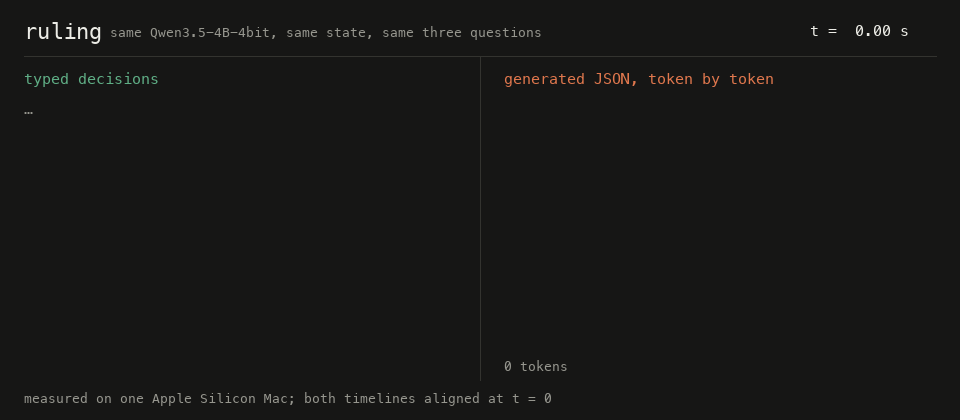
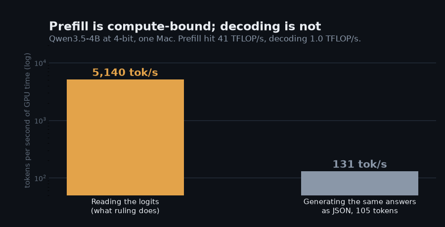

# Reference: settings, models, API, clients

Everything the front page summarizes, in full. Moved here to keep the README short; nothing was cut.

## Install and run

Requires an Apple Silicon Mac, Python 3.12+, and [uv](https://docs.astral.sh/uv/).

```bash
uv sync
uv run ruling serve          # http://127.0.0.1:8010, playground at /
```

The first start downloads the default model, `mlx-community/Qwen3.5-4B-4bit`
(about 2.3 GB). Settings come from the environment:

| Variable | Default | Meaning |
|---|---|---|
| `RULING_MODEL` | `mlx-community/Qwen3.5-4B-4bit` | The primary model. Any MLX chat model, `openai:<model>` for a model behind an OpenAI-compatible server, `openrouter:<model>`, or `typesafe:<alias>` for TypeSafe's API or any server speaking its protocol (`TYPESAFE_BASE_URL`, `TYPESAFE_API_KEY`). Tested: Qwen3.5, Llama 3.2, Gemma 3 |
| `RULING_ROTATIONS` | `3` | Answer orderings averaged per question. `1` is fastest. See How it works |
| `RULING_PRIOR_DEBIAS` | `false` | Subtract a content-free letter prior. Measured, does not help; kept so you can re-check with another model |
| `RULING_CALIBRATION` | unset | Path to a `calibration.json` written by `ruling calibrate` |
| `RULING_API_KEY` | unset | When set, `/v1/*` requires `Authorization: Bearer <key>` |
| `RULING_MAX_INPUT_TOKENS` | `65536` | Whole-request budget: state plus every question. Above this the request is rejected with 413 |
| `RULING_MAX_BRANCH_TOKENS` | `32768` | Per-branch budget: state plus one question. A single oversized question is rejected even when the request fits |
| `RULING_OPENAI_BASE_URL` | unset | Required for `openai:` models. The endpoint serving them, ending in `/v1` |
| `RULING_OPENAI_API_KEY` | unset | Sent as a bearer token when the host wants one. Local servers usually do not |
| `RULING_OPENAI_TOP_LOGPROBS` | `20` | How many top logprobs the host returns, which is also the option ceiling. OpenAI allows 20, `mlx_lm.server` allows 11 |
| `RULING_OPENAI_EXTRA_BODY` | `{}` | JSON merged into every request, for host-specific fields such as `{"chat_template_kwargs": {"enable_thinking": false}}` |
| `RULING_ADAPTER` | unset | A LoRA directory from `ruling train` or `ruling import-adapter`; see [docs/adapter.md](adapter.md) |
| `RULING_CASCADE_TO` | unset | The secondary model, in the same syntax as `RULING_MODEL`; it answers only the questions the primary is unsure about |
| `RULING_CASCADE_THRESHOLD` | unset | Top probability below which a question is escalated; required with `RULING_CASCADE_TO` |
| `RULING_FAILOVER_TO` | unset | A model that answers the whole request whenever the primary is unavailable (429, 502–504, or a timeout); the response's `model` names whichever answered |
| `RULING_MODELS` | unset | A JSON file of further models to serve by name beside the primary; see [Serve several models](#serve-several-models) |
| `RULING_MAX_PENDING` | `64` | Requests allowed in flight at once. The next one is refused with 429 `queue_full` and a `Retry-After` estimated from the queue and recent latency |
| `RULING_HOST`, `RULING_PORT` | `127.0.0.1`, `8010` | Bind address |

### Serve several models

One process can answer for more than the primary. `RULING_MODELS` names a JSON
file whose keys are model names a request may send as `model`, and whose
values say what answers under that name:

```json
{
  "routing/v1": {"model": "mlx-community/Qwen3-4B-Instruct-2507-4bit",
                 "adapter": "runs/adapters/routing", "calibration": "runs/adapters/routing/calibration.json"},
  "large":      {"model": "mlx-community/Qwen3.6-35B-A3B-4bit"}
}
```

`model` takes the same syntax as `RULING_MODEL`; `adapter` and `calibration`
are optional and resolve relative to the file. The primary is still what
`RULING_MODEL` names, and still answers `default`, `jev-latest`, and requests
with no `model`; the cascade and failover settings apply to the primary only.
Entries that fine-tune a base the server already holds share its weights: the
LoRA layers are swapped under the engine lock before each request, so a plain
base and five adapters on it cost one copy of the base. An adapter whose LoRA
layout (rank, depth) differs from the first one loaded on that base gets its
own copy. Each entry's calibration is its own and is listed in `GET /v1/models`,
so a client that applies its own temperature can see when the server already
has.

### Bring your own model

The readout needs one thing from a model: the probabilities of the next token,
restricted to your options. Three ways to give ruling that, all behind the same
API, all evaluated by the same harness:

| Your model | `RULING_MODEL` | Notes |
|---|---|---|
| An MLX checkpoint | `mlx-community/...` or a local path | Fastest: one shared prefix cache, every question in one batched forward pass |
| Anything you serve yourself | `openai:<model name>` | vLLM, SGLang, llama.cpp, LM Studio, `mlx_lm.server`, or a commercial API. Needs `/chat/completions` with `top_logprobs` |
| A model on OpenRouter | `openrouter:<model>` | Adds provider pinning and a spend budget |

```bash
python -m mlx_lm server --model mlx-community/Qwen3.5-4B-4bit --port 8080 &

export RULING_MODEL=openai:mlx-community/Qwen3.5-4B-4bit
export RULING_OPENAI_BASE_URL=http://127.0.0.1:8080/v1
export RULING_OPENAI_TOP_LOGPROBS=11
export RULING_OPENAI_EXTRA_BODY='{"chat_template_kwargs": {"enable_thinking": false}}'
uv run ruling eval datasets/authored144.jsonl
```

What a hosted model costs you: the option ceiling drops from 255 to however
many logprobs the host returns, there is no shared prefix cache so the state is
re-read for every question, and a reasoning model has to be told to stop
reasoning, differently on each host. What it buys: your model, your hardware,
any platform. An integration test runs this path end to end against a real
server and checks the distributions match the local engine's.

One-shot, without a server:

```bash
uv run ruling ask "Since this morning every request with our API key returns 401." \
  --choice "team=Which team should handle this?|billing,technical,sales" \
  --score  "urgency=How urgent is this?|Can wait,This week,Today" \
  --noul   "blocked=The customer is blocked from using the product."
```

## Training

`ruling train --data RECORDS... --output DIR` LoRA-fine-tunes the answer
readout; the README walks through a run and [docs/adapter.md](adapter.md)
describes the adapter it produces. Beyond the hyperparameters (`--steps`,
`--learning-rate`, `--lora-layers`, `--lora-rank`, `--lora-scale`, and the
rest of `ruling train --help`):

| Flag | Meaning |
|---|---|
| `--resume` | Continue from `DIR/checkpoint/`, written at every `--eval-every` step and at the end. Weights, optimizer state and step counter, the position in the batch stream, and the history all come back, so the run finishes with the same weights it would have had uninterrupted. Every setting must match the original run except `--steps`, which may be raised to extend a finished run |
| `--from-adapter DIR` | Start a fresh run, fresh optimizer and step 0, from an existing adapter's weights. Its `adapter_config.json` must match the requested LoRA layers, rank, scale and dropout |

The top-level adapter files in `DIR` are always the best validation loss so
far; `DIR/checkpoint/` is the latest step. Serve the former.

`ruling export-adapter DIR --output PEFT_DIR --base-model HF_ID` writes the
adapter in PEFT's layout, `adapter_model.safetensors` plus a `LoraConfig`,
for `PeftModel.from_pretrained` on the unquantized base `HF_ID`.
`ruling import-adapter PEFT_DIR --output DIR` is the inverse, for any PEFT
LoRA adapter whose adapted layers end the stack, which is the only shape
mlx-lm can load. A ruling adapter is trained against 4-bit MLX weights, so
under PEFT on the fp16 base it is an approximation of what ruling serves;
measure it there before trusting a threshold fitted here.

## API

`POST /v1/systemone`

```json
{
  "model": "optional; a name from GET /v1/models, or default for the primary",
  "state": "string, object, or array",
  "questions": {
    "<id>": {"type": "choice", "instructions": "...", "criteria": {"<key>": "description, JSON, or null"}},
    "<id>": {"type": "score",  "instructions": "...", "criteria": ["lowest level", "...", "highest level"]},
    "<id>": {"type": "noul",   "instructions": "a statement to judge"}
  }
}
```

Instructions, option descriptions, and levels may be strings or JSON
structure. Answers come back keyed by the same ids:

| Type | Fields |
|---|---|
| choice | `choice` (the argmax key), `probabilities` over keys, `confidence` |
| score | `score` (probability-weighted level index, so `1.74` sits between levels 1 and 2), `legend` index to level text, `probabilities` over indices, `confidence` |
| noul | `noul`, the probability the statement is true |

`usage.input_tokens` counts every token the model processed: the shared prefix
once, plus each question suffix for each ordering. `output_tokens` is always 0.

The response's `model` is the name the request selected; the primary reports
its engine's id, which a failover changes to say which side answered.

Errors come in the hosted API's shape, `{"error": {"code", "message",
"param"?}}`, where `code` is stable for programs and `message` is for people:

| Status | `code` | When |
|---|---|---|
| 422 | `invalid_input` | a malformed request (`param` names the field), a Choice over 255 options, or a state the engine refuses |
| 413 | `payload_too_large` | a request over a token limit |
| 404 | `unknown_model` | a `model` the server does not answer for; the message lists the names it does |
| 401 | `unauthorized` | an API key is configured and missing or wrong |
| 429 | `queue_full` | `RULING_MAX_PENDING` requests are already in flight; `Retry-After` says how many seconds to wait |
| 503 | `upstream_unavailable` | the primary is a hosted model and it is down, with no failover |

TypeSafe's SDK reads `error.message` from this shape and retries 429 honoring
`Retry-After`, so both clients and rulesmith behave the same against ruling
and the hosted services.

`GET /v1/models` returns `{"models": [...]}` with the hosted API's `name`,
`description` and `release_date`, plus `base` (the weights behind the name),
the Hugging Face revision, adapter digest, the calibration temperatures in
force, and limits that only a local engine knows. `GET /health` returns the
primary's name. `GET /` is a playground page.

### TypeSafe's own SDK talks to ruling

The request shape, the response shape and both paths match the hosted API, so
TypeSafe's official client needs no patching, no shim, and no code change —
only two environment variables:

```bash
export TYPESAFE_BASE_URL=http://127.0.0.1:8010
export TYPESAFE_API_KEY=whatever-you-set-as-RULING_API_KEY
```

```python
from typesafe_sdk import Choice, TypeSafeClient   # the official package, unmodified

with TypeSafeClient() as client:                  # now answered locally
    response = client.system_one(state=..., questions={"team": Choice(...)})
```

`client.system_one`, `client.models.list()`, `response.choices`,
`response.nouls`, `response.scores` and `response.usage` all work. This is
covered by an integration test that installs the real
[`typesafe-sdk`](https://github.com/typesafe-ai/typesafe-sdk-python) package
and runs it against a live ruling server, so the compatibility claim fails
loudly if either side drifts.

## Clients

Python, in this package:

```python
from ruling import Choice, Noul, Score, RulingClient

with RulingClient() as client:                          # RULING_BASE_URL or http://127.0.0.1:8010
    response = client.system_one(
        state={"message": "Since this morning every request with our API key returns 401."},
        questions={
            "team": Choice(instructions="Which team should handle this?",
                           criteria={"billing": "Charges and refunds", "technical": "Bugs and integrations"}),
            "urgency": Score(instructions="How urgent is this?", criteria=["Can wait", "This week", "Today"]),
            "blocked": Noul(instructions="The customer is blocked from using the product."),
        },
    )

team = response.answers["team"]
if team.confidence < 0.5:
    route_to_human()
elif team.choice == "technical" and response.answers["blocked"].noul > 0.9:
    page_on_call()
```

TypeScript and JavaScript, zero dependencies, in [`sdks/typescript`](../sdks/typescript):

```js
import { RulingClient, choice, noul, score } from "ruling";
const { answers } = await new RulingClient().systemOne({ state, questions: { team: choice("Which team?", { billing: null, technical: null }) } });
```

The thresholds belong in your code, versioned and tested. Fit them on labeled
data from your own traffic; see [calibration](measurements.md#evaluation-and-calibration).

## Evaluation

### Datasets

`ruling eval` and `ruling train` read a `.jsonl` file (one row per line) or a
`.json` array. A row is `{id?, state, questions, labels?, references?, family?,
weight?}`; the record format is described in
[datasets/README.md](../datasets/README.md). Rows written for hosted decision
platforms that share the System One question shape are accepted as they are. Their label
forms are normalized when the row is validated:

| Question | Hard label | Soft label |
|---|---|---|
| noul | `true`, `"true"`, `false`, `"false"` (also `"yes"`/`"no"`) | a probability of yes, or `{"true": p, "false": q}` |
| choice | the option key | `{option: p, ...}` over every option, or a list in option order |
| score | a level index `2`, its option id `"2"`, or the level text | `[p0, p1, ...]` from the lowest level up, or `{"0": p0, ...}` |

A soft label must cover every option, be non-negative, and sum to 1 within
0.02. It is stored as the record's `target` reference, with the hard label set
to its most likely option; that argmax is what accuracy scores.
A single-question row `{state, question, label}` (or `target`, or `expected`)
becomes one question named `decision`. `weight` (default 1.0, never negative)
is the row's share of a training update: a batch's loss is the weighted mean of
its rows, so weights only matter relative to each other.

### Output

`ruling eval` prints one JSON object. `question_types` holds the per-type
summaries (accuracy, balanced accuracy, calibration error, Brier, coverage at
a 5% error budget, option-reversal flips, reference agreement); those keys are
stable. Next to it sit three blocks laid out like a hosted platform's evaluation
results, each holding the same metrics dict over the labeled, scored
questions in its scope, computed on the calibrated probabilities:

- `overall`: every question pooled;
- `by_type`: keyed by `choice`, `score`, `noul`;
- `by_question`: keyed by question id.

The target `y` is the record's soft `target` reference when it has one, else
one-hot on the label. Each block is `{"n": 0}` when nothing is in scope, else:

| Key | Definition |
|---|---|
| `n` | Decisions in scope |
| `accuracy` | Share where argmax `p` equals argmax `y` |
| `nll` | Mean of −Σ `y` log `p`, with `p` floored at 1e-12 |
| `brier` | Mean of Σ (`p` − `y`)² |
| `ece` | Expected calibration error: top-1 confidence `c` is binned into 10 equal-width bins, bin `b` holding `b/10 < c ≤ (b+1)/10` (and `c = 0` in the first), and each bin adds its share of `n` times the gap between its mean confidence and its accuracy |
| `mean_confidence` | Mean top-1 probability |
| `selective` | Keyed `"0.5"`, `"0.7"`, `"0.9"`, `"0.95"`: `coverage` is the share of decisions with top-1 confidence ≥ the threshold, `accuracy` is accuracy over that share, or `null` when it is empty |

The keys and the four thresholds are fixed: other tools read them by name.

## How it works



*Same 4B model, same state, same three questions, measured on one Mac and
aligned at t = 0. ruling answered in 119 ms, median of five. Generating the
same answers as JSON took 755 ms and 105 tokens, median of three, and the
generated object invented a `refund` key inside `team` that no schema asked
for. Reproduce with `uv run --with pillow python assets/replay.py`.*

1. **One prefix, many suffixes, one forward pass.** The system prompt and the
   rendered state are pushed through the model once and the KV cache is kept.
   Each question becomes a short suffix (instructions, the options labeled
   `A.`, `B.`, `C.`, and "respond with only the letter"). All suffixes are
   right-padded into one batch and run in a single forward pass against
   replicas of the cached prefix, chunked so the replicated cache stays under a
   token budget. Adding a question adds a row to the batch, not a re-read of
   the state.
2. **Read, do not sample.** At each suffix's answer position the logits are
   restricted to the option-letter tokens and log-softmaxed. Nothing is
   decoded, so the answer is always one of your options.
3. **Ordering averaging.** Small models prefer some letters over others. With
   `RULING_ROTATIONS=n`, each Choice or Noul is scored under `n` cyclic shifts of
   its option order and each Score under both directions of its scale, and the
   log-probabilities are averaged. With `n` equal to the option count the
   result is exactly invariant to cyclic reordering of your options; there is a
   test for that.
4. **Two-stage Choice.** Above 62 options (the tokenizer's single-token codes)
   every option is first judged alone as a Noul, the strongest 8 go to a final
   Choice, and the rest get probability 0.
5. **Temperature scaling.** Log-probabilities are divided by a per-type
   temperature before the softmax. The temperature is 1 until you fit one.
6. **Confidence** follows the formulas in TypeSafe's MIT-licensed
   `system-one-adapter`, so a value here is comparable with one from the
   hosted API. Choice is `(max(p) - 1/n) / (1 - 1/n)`, how far the leading
   option stands above uniform. Score is one minus the probability-weighted
   distance from the modal level over the distance a uniform distribution
   would give, so mass spread across neighboring levels costs less than the
   same mass spread across distant ones. Both are 0 for a uniform
   distribution and 1 for a certain one. Noul answers carry no separate
   confidence; the probability is the whole answer.



*Why stopping after prefill is fast. Both bars are the same 4-bit 4B model on
the same Mac. Prefill processes every token of the prompt together and keeps
the GPU compute-bound; decoding reads the whole model out of memory for each
token it emits and leaves it memory-bound at about a fortieth of the
throughput. Regenerate with `uv run --with matplotlib python assets/charts.py`.*

